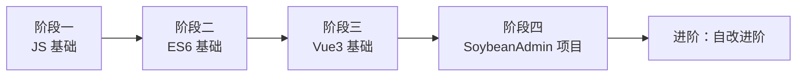

# SoybeanAdmin 学习文档（Vue3 快速上手补充篇）

> 本文件**补充**《Vue3快速上手.md》中没有、但进入本项目**必需**的知识。
> 阅读前提：已掌握 Vue3 基础语法（`ref`/`reactive`/`computed`/`watch`/组件通信等）。
> 目的是让你从「会写 Vue3 语法」过渡到「能读懂并维护 SoybeanAdmin 工程」。

---

## 📚 SoybeanAdmin 前端学习资料索引

本目录下有一套针对本项目的「基础教程 + 项目补充」配套文档：

| 基础教程 | 项目补充（针对 SoybeanAdmin） | 补充重点 |
|---------|------------------------------|---------|
| `JavaScript入门到精通.md` | **`soybean-admin学习文档-JS补充.md`** | 现代数组/对象方法、可选链、解构、async、函数式 |
| `ES6教程.md` | **`soybean-admin学习文档-ES6补充.md`** | ES2020+/ES2018+、`.at()`、对象展开、satisfies |
| `Vue3快速上手.md` | **`soybean-admin学习文档.md`（本篇）** | script setup、defineModel、icon、hooks、路由等 |

**建议学习顺序**：JS 基础 → ES6 基础 → JS/ES6 项目补充 → Vue3 基础 → 本篇（Vue3 项目补充）。

> 💡 **新手快速上手**：若只想尽快进入本项目，可直接跳到文末 **[15. 新手完整学习路线](#15-新手完整学习路线)**，里面给出了从这三份教程到本项目的分步学习地图和核心语法清单。

---

## 目录

1. [核心概念认知](#1-核心概念认知)
2. [`<script setup>` 与 `defineOptions`](#2-script-setup-与-defineoptions)
3. [本项目没有的 Vue3 新特性（重点）](#3-本项目没有的-vue3-新特性重点)
4. [`defineModel`：替代 `v-model` 双向绑定的语法糖](#4-definemodel)
5. [TypeScript 实用类型运算（贯穿全项目）](#5-typescript-实用类型运算)
6. [Element Plus 组件与自动导入](#6-element-plus-组件与自动导入)
7. [图标体系：iconify + 本地 svg](#7-图标体系)
8. [目录结构与路由（文件系统路由）](#8-目录结构与路由)
9. [请求与 API 层](#9-请求与-api-层)
10. [状态管理 pinia（项目实操）](#10-状态管理-pinia)
11. [组件的复用模式：useXxx hooks](#11-复用的核心hooks)
12. [国际化 `$t`](#12-国际化-t)
13. [风格与样式（UnoCSS）](#13-风格与样式unocss)
14. [新手实战练习建议](#14-新手实战练习建议)
15. [新手完整学习路线（JS / ES6 / Vue3 / 项目）](#15-新手完整学习路线js--es6--vue3--项目)
16. [章节 ↔ 基础教程对照总表](#16-章节--基础教程-对照总表)

---

## 1. 核心概念认知

> 📖 **对应学习**：《Vue3快速上手》3.1（Options vs Composition）｜《ES6教程》模块化、解构、箭头函数

### 1.1 这是一个「工程」而非「语法练习」

- 技术栈：**Vue 3 + TypeScript + Vite + Element Plus + UnoCSS + pinia + vue-router 4**
- 全程使用 `<script setup lang="ts">` 组合式 API。
- 大量依赖**自定义 hooks**（`useXxx`）和**全局组件**，这是理解和复用的关键。

### 1.2 你会在每个组件里反复看到的三件事

| 模式 | 说明 | 例子 | 对应学习 |
|------|------|------|---------|
| **props 传参** | 父组件向下传数据 | `<MenuOperateModal :operate-type="type" .../>` |《Vue3快速上手》6.1 |
| **emit 回调** | 子组件通知父组件 | `emit('submitted')` 后父组件刷新列表 |《Vue3快速上手》6.2 |
| **useXxx hooks** | 抽出可复用逻辑 | `useForm()`、`useTableOperate()` |《Vue3快速上手》3.14 |

---

## 2. `<script setup>` 与 `defineOptions`

> 📖 **对应学习**：《Vue3快速上手》3.2（setup 语法糖）｜ES6 无此概念

### 2.1 `script setup` 语法糖

《快速上手》已介绍这是 setup 的语法糖。但注意：

- **模块顶层可以直接写代码**（不需要 return），模板自动拿到所有顶层绑定。
- **没有 `this`**。

### 2.2 `defineOptions`（本项目必用）

因为 `script setup` 不能直接写 `{ name: 'Xxx' }`，需要用 `defineOptions` 指定组件名（用于调试、keep-alive 等）：

```ts
<script setup lang="ts">
defineOptions({ name: 'MenuOperateModal' });
</script>
```

---

## 3. 本项目没有的 Vue3 新特性（重点）

> 📖 **对应学习**：以下特性《Vue3快速上手》均**未收录**（属 Vue3.4+ / TS 能力），属本项目补充。
> 对应的「基础」知识请对照：《Vue3快速上手》3.12（props）、3.11（ref）、6.4（v-model）、6.5（$attrs）。

### 3.1 `defineModel`（Vue 3.4+）

**作用**：简化「组件标签上的 `v-model`」双向绑定。快手上手 6.4 讲的是传统的 `props + emit('update:modelValue')`，本项目直接用更简洁的 `defineModel`。

> 📖 **对应学习**：《Vue3快速上手》6.4（v-model 本质）——先看它理解 `v-model` 原理，再看本项目 `defineModel`。

```ts
// 子组件
const visible = defineModel<boolean>('visible', { default: false });
// 相当于自动生成了 props 的 visible 和 emit('update:visible')
```

父组件用法不变：

```html
<MenuOperateModal v-model:visible="visible" />
```

**要点**：`defineModel('visible')` 对应父组件 `v-model:visible`；`defineModel()`（不带参数）对应 `v-model`。读写 `visible.value` 即可，无需手动 emit。

### 3.2 `defineProps` 与 `withDefaults`

快速上手 3.12 只介绍了基础。本项目常用「TypeScript 类型声明 + 默认值」：

> 📖 **对应学习**：《Vue3快速上手》3.12（props 三种写法）——本项目是它的「类型化 + 默认值」进阶。

```ts
interface Props {
  operateType: OperateType;
  rowData?: Api.SystemManage.Menu | null;
  allPages: string[];
}
const props = defineProps<Props>();   // 只声明类型

// 若要给可选 prop 设默认值，用 withDefaults：
const props = withDefaults(defineProps<{ list?: string[] }>(), {
  list: () => []
});
```

### 3.3 `defineEmits` 类型化写法

> 📖 **对应学习**：《Vue3快速上手》6.2（自定义事件）——本项目用「函数重载」形式做类型约束。

```ts
interface Emits {
  (e: 'submitted'): void;
}
const emit = defineEmits<Emits>();
```

> 注意：这里用了「函数重载」形式的 Emits 声明，是 Vue3 类型化事件的标准写法。

### 3.4 `defineExpose`（组件标签 ref 取子组件数据）

快速上手 3.11 提到要配合 `defineExpose`，本项目同样遵循：

> 📖 **对应学习**：《Vue3快速上手》3.11（标签的 ref 属性，组件标签上用 → 需 defineExpose）。

```ts
defineExpose({ count, increment });
```

### 3.5 `useAttrs` 与 `$attrs`

快速上手 6.5 用模板 `$attrs`，本项目常在 `script` 里用 `useAttrs()`（见 `svg-icon.vue`）：

> 📖 **对应学习**：《Vue3快速上手》6.5（$attrs 祖孙通信）——本项目换用 `useAttrs()` 在脚本里读取。

```ts
const attrs = useAttrs();
const bindAttrs = computed(() => ({
  class: (attrs.class as string) || '',
  style: (attrs.style as string) || ''
}));
```

### 3.6 `h()` 渲染函数与 TSX

本项目某些组件（如表单 option、菜单表格列）允许使用 `tsx` 或 `render`。快速上手只提到 JSX，这里补充：

> 📖 **对应学习**：《ES6教程》无｜《Vue3快速上手》第 2 章 JSX 支持（简介）。`h()` 为 Vue3 渲染函数 API，本项目知识点。

```tsx
h(SvgIcon, { localIcon: value, class: 'text-icon' })  // 渲染函数创建 VNode
```

在 `.vue` 的 `script setup lang="tsx"` 里也可以直接写 JSX：

```tsx
return <ElTag type="primary">{label}</ElTag>;
```

---

## 4. `defineModel`

见 [3.1](#31-definemodelvue-34)，这是本项目最常用、且最容易给新手造成困惑的特性。**记住它就够了**：`defineModel('visible')` ⇔ 父组件 `v-model:visible`。

> 📖 **对应学习**：《Vue3快速上手》6.4（v-model 本质）。

---

## 5. TypeScript 实用类型运算

本项目重度使用 TS 类型运算，快速上手文档完全没涉及。以下是最常见的：

> 📖 **对应学习**：属 **TypeScript 类型系统**，三份教程均无直接章节。但所需**基础语法**来自：
> - `?.` 可选链 →《ES6教程》无（属 ES2020，见 `soybean-admin学习文档-ES6补充.md` 第 1 章）
> - 对象/数组操作 →《JavaScript入门到精通》
> - 交叉类型、泛型 `Pick/Omit` → 需另行补 TS 知识

| 运算符 | 作用 | 示例 | 对应学习 |
|--------|------|------|---------|
| `Pick<T, K>` | 从类型 T 挑出某些字段 | `Pick<Api.SystemManage.Menu, 'menuType' \| 'menuName'>` | TS 类型（补学） |
| `Extract<T, U>` | 从联合类型 T 中筛出 U 中的成员 | `Extract<keyof Model, 'menuName' \| 'status'>` | TS 类型（补学） |
| `Omit<T, K>` | 排除某些字段 | `Omit<Model, 'query' \| 'buttons'>` | TS 类型（补学） |
| `Record<K, V>` | 构造「键为 K，值为 V」的对象类型 | `Record<OperateType, string>` | TS 类型（补学） |
| `&`（交叉类型） | 合并多个类型 | `Pick<...> & { query: ...; buttons: ... }` | TS 类型（补学） |
| `Array<T>` / `T[]` | 数组 | `string[]` |《ES6教程》数组 |
| 可选 `?` 或 `?.` | 可选与空值处理 | `rowData?: ...`、`formRef.value?.validate()` |《ES6教程》无，见 ES6补充 1.1 |

**实战中看到 `Pick`、`Extract`、`Record` 时**，就是在做「取子集 / 筛类型 / 建映射」三个动作，别怕。

---

## 6. Element Plus 组件与自动导入

快速上手文档没有涉及 UI 库。本项目 UI 库是 **Element Plus**，且做了**自动按需导入**。

> 📖 **对应学习**：三份教程均无 UI 库内容，属「工程基建」。需要的基础是：
> - `v-model` 双向绑定 →《Vue3快速上手》6.4
> - 组件标签用法（`<ElButton>`）本质同自定义组件 →《Vue3快速上手》6.1/6.9

### 6.1 为什么能直接写 `<ElButton>` 而不 import

在 `build/plugins/unplugin.ts` 里配置了 `unplugin-vue-components` 的 `ElementPlusResolver`，**构建时自动把 template 里出现的 `ElXxx` 解析并注册**，生成的类型在 `src/typings/components.d.ts`。

所以你在任何 `.vue` 里都可以**直接使用**：

```html
<ElDialog v-model="visible">
  <ElForm>
    <ElButton type="primary">确定</ElButton>
  </ElForm>
</ElDialog>
```

**无需手动 import！** 只有 `SvgIcon` 这类**项目自定义**组件才需要手动 import。

### 6.2 常用组件速查

| 组件 | 用途 | 对应学习 |
|------|------|---------|
| `ElDialog` | 弹窗 | 组件 + `v-model`（6.4） |
| `ElForm` / `ElFormItem` | 表单 | — |
| `ElInput` / `ElSelect` / `ElRadioGroup` / `ElInputNumber` | 输入控件 | `v-model`（6.4） |
| `ElButton` | 按钮 | — |
| `ElTable` / `ElTableColumn` | 表格 | — |
| `ElTag` | 标签（状态展示） | — |
| `ElPagination` | 分页器 | — |
| `ElSpace`、`ElRow`、`ElCol` | 布局 | — |

### 6.3 全局组件默认配置

`src/plugins/ui.ts` 修改了部分组件默认 props（如表格列默认居中、Card 无阴影、表单星号在右），可留意。

---

## 7. 图标体系

快速上手完全没有图标内容。本项目图标分两套：**iconify** 和**本地 svg**。

> 📖 **对应学习**：与三份教程关联较弱，主要用到：
> - `map()` 数组转换 →《ES6教程》7（Array API）/《JavaScript入门到精通》
> - 路径解析 `split`/`.at()` →《ES6教程》字符串 / `soybean-admin学习文档-ES6补充.md` 第 4 章
> - 可选链 `?.` →`soybean-admin学习文档-ES6补充.md` 第 1 章

### 7.1 全局组件 `SvgIcon`（`src/components/custom/svg-icon.vue`）

同时支持两种图标，传 `icon`（iconify）或 `localIcon`（本地 svg），**localIcon 优先**。

```html
<!-- iconify 图标 -->
<SvgIcon icon="mdi-emoticon" class="text-icon" />
<!-- 本地 svg 图标（文件名不带 .svg） -->
<SvgIcon local-icon="custom-icon" class="text-icon" />
```

### 7.2 直接写组件标签（静态用法）

UnoCSS 预设把 `icon-xxx` 这类标签注册为图标组件：

```html
<icon-carbon-add class="align-sub text-icon" />
<icon-ic-round-search class="text-icon" />
```

- `icon-` 前缀由 `.env` 的 `VITE_ICON_PREFIX=icon` 决定。
- `mdi-`、`carbon-`、`ic-round-` 是 iconify 的图标集合名。

### 7.3 获取本地图标列表

`src/utils/icon.ts` 的 `getLocalIcons()` 用 `import.meta.glob` 扫描 `src/assets/svg-icon/*.svg`，返回文件名数组，用于做下拉选项：

```ts
const localIcons = getLocalIcons();
const localIconOptions = localIcons.map(item => ({ value: item }));
```

### 7.4 找图标

- iconify：<https://icones.js.org/>，复制名字如 `mdi-emoticon`。
- 本地 svg：往 `src/assets/svg-icon/` 放 `.svg` 文件即可自动可用。

---

## 8. 目录结构与路由

> 📖 **对应学习**：《Vue3快速上手》第 4 章（路由）——先看它理解路由基础，再看本项目「文件系统/动态路由」差异。
> 需要的 JS 基础：`import`/`export` →《ES6教程》20（模块化）；`forEach` →《ES6教程》7。

### 8.1 关键目录速查

```
src/
  views/            路由页面（一个目录一个功能）
  components/       通用组件（custom 下是自定义组件）
  hooks/            自定义 hooks（common 共用、business 业务）
  store/modules/    pinia 状态
  service/api/      请求接口层
  router/           路由（elegant 是文件系统路由自动生成）
  locales/          国际化语言包
  constants/        常量（业务枚举等）
```

### 8.2 文件系统路由（elegant router）

快速上手 4 章讲的是手写路由表。本项目用**文件系统路由**（`vue-router` 4 + 自动生成），`src/router/elegant/` 由目录结构自动生成路由。

- 「新增一个页面」= 在 `src/views/xxx` 新建 `.vue` 文件，路由自动生成。
- 菜单数据由后端/动态路由驱动（参见 `menu/index.vue` 的业务）——这和第 4 章手写 `routes` 不同，是**动态路由**。

### 8.3 编程式导航

快速上手 4.11 已介绍 `useRouter`/`useRoute`，本项目同样使用：

> 📖 **对应学习**：《Vue3快速上手》4.11（编程式导航）。

```ts
import { useRouter, useRoute } from 'vue-router';
const router = useRouter();
const route = useRoute();
```

---

## 9. 请求与 API 层

快速上手没有请求层。本项目封装了请求，`src/service/api/` 下的函数统一返回 `{ error, data }` 结构。

> 📖 **对应学习**：
> - `async/await` 异步 →《ES6教程》14（Promise）进阶（ES2017，见 `soybean-admin学习文档-ES6补充.md` 第 3 章）
> - 解构 `{ error, data }` →《ES6教程》3（解构赋值）
> - 对象展开/合并 →《ES6教程》10（spread）/ ES6补充 第 2 章

```ts
const { error, data } = await fetchGetAllRoles();
if (!error) {
  // 使用 data
}
```

**要点**：不要直接写 `axios.get(...)`，一律通过 `src/service/api` 里的封装函数，已统一处理错误、token、loading 等。

---

## 10. 状态管理 pinia

快速上手 5 章已介绍 pinia 基础。本项目注意事项：

> 📖 **对应学习**：《Vue3快速上手》第 5 章（pinia）——尤其 5.5（storeToRefs）、5.8（组合式写法）。

### 10.1 组合式 store（Setup Store）

对比快速上手 5.8 的组合式写法，本项目 store 在 `src/store/modules/`。使用方式一致：

```ts
import { useAppStore } from '@/store/modules/app';
const appStore = useAppStore();
```

### 10.2 用 `storeToRefs` 解构数据

读取 store 里的**状态**时，用 `storeToRefs` 保持响应式（快速上手 5.5）：

> 📖 **对应学习**：《Vue3快速上手》5.5（storeToRefs）。

```ts
import { storeToRefs } from 'pinia';
const { isDarkMode } = storeToRefs(useThemeStore());
// 方法直接解构即可
const { toggleDarkMode } = useThemeStore();
```

---

## 11. 复用的核心 hooks

快速上手 3.14 讲了什么是 hook。本项目把大量逻辑封装成了 `useXxx`，看懂这些就能读懂大部分组件。

> 📖 **对应学习**：《Vue3快速上手》3.14（自定义 hook）——本项目 hook 是它的工程化应用。

### 11.1 关键 hooks 一览（`src/hooks/`）

| Hook | 用途 | 用到的基础 |
|------|------|-----------|
| `useBoolean` | 布尔状态 + `setTrue/setFalse/toggle`（控制弹窗显隐） | `ref`（3.3） |
| `useForm` | 表单校验封装（`formRef`、`validate`、`restoreValidation`） | `ref`、标签 ref（3.11） |
| `useFormRules` | 通用校验规则（必填、用户名、密码、邮箱等） | 正则（JS 教程） |
| `useTableOperate` | 表格增删改的选中、批量删除处理 | 数组方法（ES6 7） |
| `useUIPaginatedTable` | 表格 + 分页 + 加载的数据封装 | `ref`/`computed` |
| `useSvgIcon` | 生成 `SvgIconVNode`（用于 render 函数渲染图标） | `h()`（本篇 3.6） |

### 11.2 常见使用模式

```ts
// 控制弹窗显隐
const { bool: visible, setTrue: openModal } = useBoolean();

// 表单校验
const { formRef, validate, restoreValidation } = useForm();
```

**一切 `useXxx` 都是「返回一些响应式数据和函数的普通函数」**，原理与快速上手 3.14 的 `useSum` 一模一样，只是封装得更复杂。

---

## 12. 国际化 `$t`

快速上手没有国际化。本项目内置了 vue-i18n，模板和脚本里用 `$t()` 取文案：

> 📖 **对应学习**：与三份教程无直接对应（属 i18n 生态）。只用到模板绑定 `{{ }}`（《Vue3快速上手》2.3）与 `computed`（3.8）。

```html
{{ $t('page.manage.menu.title') }}
```

```ts
import { $t } from '@/locales';
const title = computed(() => $t('page.manage.menu.addMenu'));
```

文案 key 定义在 `src/locales/langs/` 下，按模块分组（如 `page.manage.menu.xxx`）。

---

## 13. 风格与样式（UnoCSS）

本项目用 **UnoCSS**（原子化 CSS）而非普通 CSS。快速上手没有涉及。

> 📖 **对应学习**：与三份教程无直接对应（属 CSS 原子化方案）。模板 class 绑定即 HTML/CSS 基础。

### 13.1 原子类写法

直接在 class 里写工具类，不需要写 `<style>`：

```html
<div class="flex-center gap-16px text-24px text-red">
```

常用类：
- `flex`、`flex-col`、`flex-center`、`flex-y-center`
- `gap-16px`（间距）
- `text-24px`（字号）、`text-red`（颜色）
- `w-full`、`h-full`、`mt-20px`、`p-10px`
- `border-dashed`、`align-sub`

### 13.2 什么时候写 `<style scoped>`

需要特殊样式或覆盖组件内部样式（下钻 `:deep`）时再写：

```scss
<style lang="scss" scoped>
:deep(.el-card) { ... }
</style>
```

---

## 14. 新手实战练习建议

**不要通读全部源码**，按「功能切片」逆推学习：

> 📖 **对应学习**：本节省略，直接按步骤实操。需要的基础跨越：`menu-operate-modal.vue` →《Vue3快速上手》3.2/3.3/3.8/3.9/6.1/6.2 全部核心语法。

1. **选一个简单页面**（如 `src/views/home`），看它怎么组合组件、请求数据。
2. **选一个表单弹窗**（如 `menu/modules/menu-operate-modal.vue`），走通「打开 → 填表 → 校验 → 提交 → 通知父刷新」链路。
3. **改一个小功能**：给菜单弹窗加一个新字段，把整个链路自己实现一遍。
4. **再深入**：请求层 → 状态管理 → 路由动态生成。

> 先用本补充文档看懂「项目怎么用 Vue3」，再用《快速上手》补「Vue3 本身是什么」，两者结合即可读懂整个工程。

---

## 附：快速上手缺、本项目多的高频特性清单

| 特性 | 快速上手 | 本项目 |
|------|:---:|:---:|
| `defineModel` | ❌ | ✅ 高频 |
| `withDefaults` | ⚠️ 简略 | ✅ |
| `defineOptions` | ❌ | ✅ |
| `defineExpose` | ⚠️ 简略 | ✅ |
| `useAttrs` | 仅模板 | ✅ script 中使用 |
| `h()` / TSX | 仅 JSX | ✅ |
| 自动按需导入 UI | ❌ | ✅ |
| 文件系统/动态路由 | ❌ | ✅ |
| 请求封装层 | ❌ | ✅ |
| UnoCSS 原子化 | ❌ | ✅ |
| 国际化 `$t` | ❌ | ✅ |
| `import.meta.glob` | ❌ | ✅ |

---

## 15. 新手完整学习路线（JS / ES6 / Vue3 / 项目）

> 这一章把《JavaScript入门到精通》《ES6教程》《Vue3快速上手》三份基础教程 + 本系列补充文档，整合成一条**从零到能维护 SoybeanAdmin 的完整学习地图**。

### 15.1 总览：四阶段学习地图



| 阶段 | 学什么 | 用哪份文档 | 达到的目标 |
|:---:|--------|-----------|-----------|
| **一** | JavaScript 基础 | `JavaScript入门到精通.md` | 看懂变量/函数/对象/数组/异步 |
| **二** | ES6 现代语法 | `ES6教程.md` + `soybean-admin学习文档-ES6补充.md` | 看懂模板字符串/解构/箭头/Promise/可选链 |
| **三** | Vue3 组合式 API | `Vue3快速上手.md` + 本篇 | 看懂 component/响应式/通信 |
| **四** | 本项目工程落地 | **本篇** + `soybean-admin学习文档-JS补充.md` | 能读懂并修改本项目代码 |

### 15.2 各阶段核心语法清单与重点方向

#### 阶段一：JavaScript 核心语法（`JavaScript入门到精通.md`）

**必须掌握（对应读本项目代码的最低要求）：**

| 语法/概念 | 重点 | 本项目出现处 | 对应学习 |
|-----------|------|-------------|---------|
| 变量 `let`/`const` | 优先 `const` | 到处 | 第1篇 二（变量） |
| 函数与箭头函数 | 回调函数 | 到处 | 第2篇 一（函数）/ 第6篇 四（函数进阶） |
| 对象与数组 | 增删改查 | 到处 | 第2篇 二/三（对象、内置对象） |
| `forEach`/`map`/`filter` | 数组处理 | 列表数据 | 第2篇 三（内置对象·Array） |
| 三元运算符 `条件 ? a : b` | 条件渲染 | 表格列 | 第1篇 三（运算符） |
| 模板字符串 `` `...${x}` `` | 拼接 | 图标名/路由 |《ES6教程》四（模板字符串） |
| 解构赋值 | 取 props/hooks 返回值 | 到处 |《ES6教程》三（解构赋值） |
| 异步（Promise 概念） | 请求回调 | 请求层 |《ES6教程》十四（Promise）/ 第6篇 四（函数进阶） |

**可以了解（不阻塞读代码）：** 闭包、原型/`class`、DOM 操作（本项目几乎不用于 DOM，交给 Vue）。

#### 阶段二：ES6 与 ES6+ 核心语法（`ES6教程.md` + ES6补充）

| 语法 | 重点 | 重要程度 | 对应学习 |
|------|------|:---:|---------|
| `let`/`const` 块级作用域 | 理解作用域 | ⭐⭐⭐ |《ES6教程》二 |
| 解构赋值 | 数组/对象解构 | ⭐⭐⭐ |《ES6教程》三 |
| 模板字符串 | `\`${}\`` | ⭐⭐⭐ |《ES6教程》四 |
| 箭头函数 | 简写与 `this` | ⭐⭐⭐ |《ES6教程》六 |
| 展开/剩余 `...` | 复制/合并/取剩余 | ⭐⭐⭐ |《ES6教程》九、十 |
| Promise | `.then`/`.catch` | ⭐⭐⭐ |《ES6教程》十四 |
| 模块 `import`/`export` | 组织代码 | ⭐⭐⭐ |《ES6教程》二十 |
| **可选链 `?.`** | 安全访问 | ⭐⭐⭐ | ES6补充 1（基础无） |
| **空值合并 `??`** | 默认值（区别于 `\|\|`） | ⭐⭐⭐ | ES6补充 1（基础无） |
| **async/await** | 替代 Promise 链 | ⭐⭐⭐ | ES6补充 3（基础无） |
| **对象展开 `{...x}`** | 浅拷贝/覆盖 | ⭐⭐⭐ | ES6补充 2（基础无） |
| **`.at(-1)`** | 取末尾元素 | ⭐⭐ | ES6补充 4（基础无） |
| **`.find()`/`.includes()`** | 查找/判断 | ⭐⭐ | ES6补充 4（基础部分有） |

> 带 **粗体** 的是《ES6教程》原文没有、但本项目高频的（详见 `soybean-admin学习文档-ES6补充.md`）。

#### 阶段三：Vue3 核心语法（`Vue3快速上手.md` + 本篇第 2~7 章）

| 语法 | 对应快速上手 | 重点 |
|------|:---:|------|
| `setup`/`<script setup>` | 3.2 | 组合式 API 入口 |
| `ref` / `reactive` | 3.3~3.6 | **本项目对象多用 `ref`** |
| `computed` | 3.8 | 派生数据 |
| `watch` / `watchEffect` | 3.9~3.10 | 监听变化、弹窗初始化 |
| 标签 `ref` | 3.11 | DOM/组件引用 |
| `props` / `emit` | 3.12 / 6.1~6.2 | 组件通信 |
| `v-model` | 6.4 | 双向绑定 |
| `provide`/`inject` | 6.7 | 祖孙通信 |
| `slot` | 6.9 | 插槽 |
| 生命周期 `onMounted` 等 | 3.13 | 挂载时机 |
| **`defineModel`** | ❌（本篇 3.1） | 本项目高频替代 v-model |
| **`defineOptions`** | ❌（本篇 2.2） | 声明组件名 |
| **`useXxx` hooks** | 3.14 → 本篇 11 | 复用逻辑 |

#### 阶段四：SoybeanAdmin 项目重点方向（本篇第 6~13 章）

| 方向 | 对应本篇 | 为什么要学 |
|------|---------|-----------|
| Element Plus 自动导入 | 6 | 直接 `<ElButton>` 不用 import |
| 图标体系 | 7 | `SvgIcon` + `iconify` |
| 目录结构与动态路由 | 8 | 明白页面放哪、路由怎么来 |
| 请求封装层 | 9 | 统一 `{ error, data }` |
| pinia 状态管理 | 10 | 全局状态 |
| hooks 复用 | 11 | 读懂 `useForm`/`useTableOperate` |
| 国际化 `$t` | 12 | 所有文案 |
| UnoCSS 样式 | 13 | 原子类写样式 |

### 15.3 推荐实操路径（由浅入深，对照真实文件）

**第 1 步 — 理解一个「简单页面」**
- 打开 `src/views/home`，看它如何组合组件、请求数据。
- 关注它的 `import`、`useXxx`、`<template>` 绑定。

**第 2 步 — 理解一个「弹窗表单」（最关键）**
- 打开 `src/views/manage/menu/modules/menu-operate-modal.vue`。
- 走通完整链路：**打开（watch visible）→ 初始化 → 填表（v-model）→ 校验（useForm）→ 提交 → emit 通知父组件刷新**。
- 这是本项目「增删改查」的标配套路，学会了能套用到所有表单页。

**第 3 步 — 理解「父组件如何驱动弹窗」**
- 打开 `src/views/manage/menu/index.vue`。
- 看它如何用 `useBoolean` 控制弹窗、传入 `props`、监听 `submitted` 刷新列表。

**第 4 步 — 理解「列表 + 分页」封装**
- 看 `useUIPaginatedTable`（表格、分页、loading 的封装）。

**第 5 步 — 自己动手改一个小功能**
- 例如给菜单弹窗新增一个表单字段：加 `model` 字段 → 加表单项 → 加校验 → 提交。
- **动手跑通一遍，比读十遍有效。**

### 15.4 新手常见误区

| 误区 | 正确做法 |
|------|---------|
| 想先把三份教程全部背熟再碰项目 | **边看项目边补**，以功能切片反推语法 |
| 纠结 `reactive` 还是 `ref` | 先跟项目习惯：对象也用 `ref` |
| 以为要手动 import 所有组件 | `ElXxx` 已自动导入，自定义组件才要 import |
| 手动操作 DOM | 全交给 Vue 响应式/模板 |
| 用 `var` 或 `==` | 用 `const`/`let`、`===` |
| 在组件里直接 `axios.request` | 走 `src/service/api` 的封装 |

### 15.5 一句话总结

> **先看本项目怎么写（第 1~14 章），再回头补基础（阶段一~三）；用「功能」当线索，用「语法」当查漏工具。** 当你能完整说出上面第 2 步弹窗表单那条链路的每一句话对应哪个语法时，你就已经入门 SoybeanAdmin 了。

---

## 16. 章节 ↔ 基础教程 对照总表

> 本表把本篇 1~14 章的知识点，与《JavaScript入门到精通》《ES6教程》《Vue3快速上手》及两份「项目补充」文档**一一对应**，方便你随时跳回基础教程查漏。

| 本篇章节 | 核心知识点 | 对应《Vue3快速上手》 | 对应《ES6教程》 | 对应《JS入门到精通》 |
|---------|-----------|:---:|:---:|:---:|
| 1. 核心概念 | 组合式API、props/emit/hooks | 3.1、6.1、6.2、3.14 | 模块化 20 | — |
| 2. script setup | `<script setup>`、`defineOptions` | 3.2 | — | 函数/对象 |
| 3.1 `defineModel` | 替代 v-model 双向绑定 | 6.4（前置） | — | — |
| 3.2 `defineProps` | props 类型化 + 默认值 | 3.12 | — | — |
| 3.3 `defineEmits` | 类型化事件 | 6.2 | — | — |
| 3.4 `defineExpose` | 暴露子组件数据 | 3.11 | — | — |
| 3.5 `useAttrs` | 读取 attrs | 6.5 | — | — |
| 3.6 `h()`/TSX | 渲染函数 | 2（JSX） | — | — |
| 5. TS 类型运算 | Pick/Omit/Record | —（需补 TS） | — | — |
| 6. Element Plus | 自动导入、`<ElButton>` | 6.4、6.1 | — | — |
| 7. 图标体系 | iconify + 本地 svg | — | map 7、字符串 | — |
| 8. 路由 | 文件系统/动态路由 | 4.1~4.12 | 模块化 20 | — |
| 9. 请求层 | async/await、`{error,data}` | — | Promise 14 | — |
| 10. pinia | storeToRefs、组合式 store | 5.1~5.8 | — | — |
| 11. hooks | useXxx 复用 | 3.14 | — | — |
| 12. 国际化 `$t` | i18n 文案 | 2.3、3.8 | — | — |
| 13. UnoCSS | 原子化样式 | — | — | — |

### 16.1 需要「另补知识」的点

以下在本篇出现、但三份基础教程 **都没有直接讲**，需单独补：

| 知识点 | 去哪补 |
|--------|--------|
| 可选链 `?.`、空值合并 `??` | `soybean-admin学习文档-ES6补充.md` 第 1 章 |
| async/await | `soybean-admin学习文档-ES6补充.md` 第 3 章 |
| 对象展开 `{...x}` | `soybean-admin学习文档-ES6补充.md` 第 2 章 |
| `.at(-1)` 等新数组方法 | `soybean-admin学习文档-ES6补充.md` 第 4 章 |
| `Object.assign`、`Object.keys` | `soybean-admin学习文档-JS补充.md` 第 3 章 |
| TS 类型运算（Pick/Omit/Record） | 单独 TypeScript 教程 |
| `defineModel`/`useAttrs`/TSX | 本篇 3.1/3.5/3.6（Vue3.4+ 特性） |
